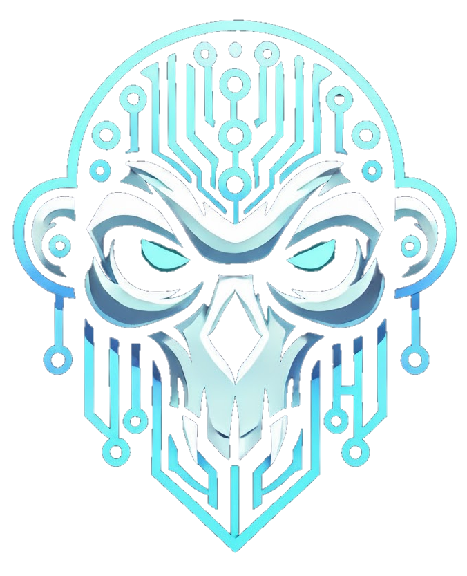

# Hi there 👋, I'm Guilherme "MiKiN" Lopes

### Backend Software Engineer | Go & Python | Distributed Systems | Applied AI

Control and Automation Engineer building distributed systems, APIs and connected products, from architecture to production operations. My background in embedded systems and IoT means I'm comfortable anywhere from device firmware to LLM platforms.

Based in Brazil, working remotely (UTC-3). Open to backend and applied AI roles.

---

### 🤖 Talk to MiKiN, my Personal AI Agent!

I've built a digital version of myself to answer your questions. Want to know more about my experience, skills, or past projects? **[Head over to mikin.ai](https://mikin.ai)** and ask him anything!

 

---

## 🌟 About Me

- 🛠️ **Building [AI Portfolio Template](https://github.com/GuilhermeMikin/ai-portfolio-template):** an open-source portfolio with an AI assistant that answers from your own content, extracted from mikin.ai.
- 🚀 **Building PiKiTo Pages:** a landing-page platform where a coding agent turns each order's briefing into a repo, copy and a preview deploy.
- 🌱 **Studying:** finishing a postgraduate degree in Applied AI Engineering (Dec 2026).
- 💼 **Most recently:** Tech Lead at Envor Technologies (2024–2026), where I led a multi-tenant LLM platform from zero to pre-launch, shipped a Go number-portability gateway across 3 telecom operators, and built the Go rating service of an SMS billing pipeline at ~10M CDRs/day, with automated re-rating that cut errors from about 10% to 0.1%.
- 📡 **Before that:** IoT R&D at Wisebyte, running a fleet of 1,500+ devices from C/C++ firmware to Python backend.

---

## 🛠️ Tech Stack

---

## 📫 How to Reach Me

- **LinkedIn**: [linkedin.com/in/guilhermebl](https://www.linkedin.com/in/guilhermebl/)
- **Email**: [guilhermebalopes@gmail.com](mailto:guilhermebalopes@gmail.com)
- **Portfolio & AI Agent**: [mikin.ai](https://mikin.ai)
